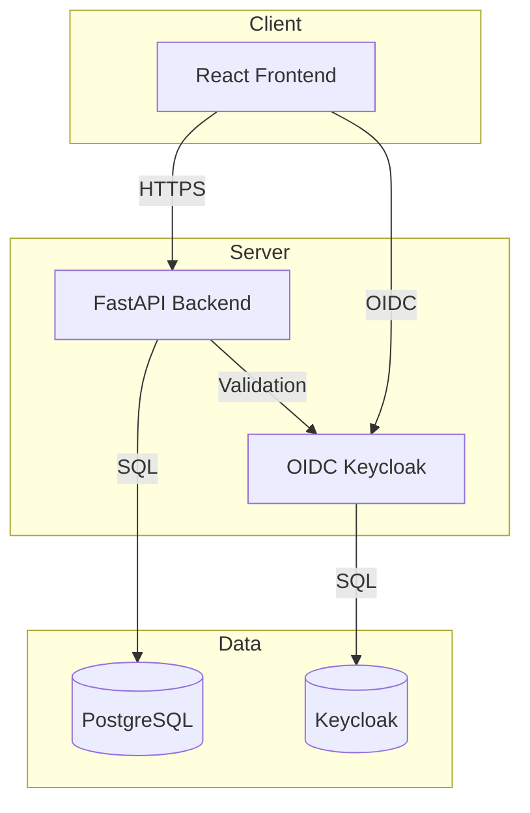

# Signal Console — Ryan Vo

Current version: `1.0.0`.

**Hindsight: Agent Memory That Learns** — Ryan Vo | AI & Machine Learning

Signal Console is a developer tool for AI/ML agent memory management. It provides long-term memory retention, semantic recall, and consolidation workflows so agents can learn from past interactions across sessions.

## Problem

AI agents lose context between sessions. They cannot remember facts from previous conversations, leading to repeated mistakes, hallucinations, and inability to build cumulative knowledge. Signal Console solves this by providing a persistent memory layer with structured extraction, semantic search, and automated consolidation.

## Approach

- **Retention**: Ingest conversation turns, extract structured facts with metadata and tags using deterministic algorithms (LLM opt-in for enrichment)
- **Recall**: Semantic search with timestamp-aware ranking — every memory surfaces its age so agents can reason about staleness
- **Consolidation**: Automated derivation of higher-level observations from raw facts, with audit trail and rollback

## Architecture



## Features

- **Memory Banks**: Isolated namespaces for different agents/projects with CRUD, pagination, filtering
- **Retention Workflow**: Append/replace modes, tagging, metadata, deterministic extraction pipeline
- **Recall Workflow**: Semantic search with filters, timestamp display (mentioned_at, occurred_start), export
- **Consolidation Workflow**: Trigger consolidation, poll status, browse observations/facts
- **Authentication**: OIDC Keycloak with PKCE, HttpOnly cookies, CSRF protection, role-based access (admin/operator/analyst)
- **Demo Mode**: Local-only development mode with auto-login (disabled in production)

## Quick Start

### Prerequisites

- Docker & Docker Compose
- Node 24+ (for local frontend dev)
- Python 3.12+ (for local backend dev)

### Docker Compose (Recommended)

```bash
# Clone and enter
git clone https://github.com/A220man/signal-console-ryan-vo.git
cd signal-console-ryan-vo

# Copy env and customize
cp .env.example .env
# Edit .env with secure passwords

# Start all services
docker compose up --build -d

# Verify
curl http://127.0.0.1:8000/health
# {"status":"ok","database":"healthy","version":"1.0.0"}

# Open frontend
open http://127.0.0.1:5173
```

Keycloak admin: http://127.0.0.1:8080 (admin / from .env)

### Local Development

```bash
# Backend
python3 -m venv .venv
source .venv/bin/activate
pip install -r backend/requirements.txt
cp .env.example .env
# Edit .env for local dev (DEMO_MODE=true, SQLite)
uvicorn app.main:app --reload --host 127.0.0.1 --port 8000

# Frontend (separate terminal)
cd frontend
npm install
npm run dev
# Opens http://127.0.0.1:5173
```

## Testing

### Backend Tests

```bash
source .venv/bin/activate
PYTHONPATH=backend python -m pytest backend/tests -v
```

### Frontend Tests

```bash
cd frontend
npm install
npm test
```

### Build Verification

```bash
# Backend typecheck (implicit in pytest)
# Frontend typecheck + build
cd frontend && npm run build
```

## API Reference

### Health
- `GET /health` — System health with database connectivity
- `GET /health/ready` — Kubernetes readiness probe

### Memory Banks
- `POST /api/v1/banks` — Create bank
- `GET /api/v1/banks` — List banks (paginated, filtered)
- `GET /api/v1/banks/{bank_id}` — Get bank
- `PATCH /api/v1/banks/{bank_id}` — Update bank
- `DELETE /api/v1/banks/{bank_id}` — Delete bank

### Memories / Retention (planned)
- `POST /api/v1/banks/{bank_id}/memories` — Retain memories (append/replace)
- `GET /api/v1/banks/{bank_id}/memories` — List memories
- `GET /api/v1/banks/{bank_id}/memories/{memory_id}` — Get memory
- `DELETE /api/v1/banks/{bank_id}/memories/{memory_id}` — Delete memory

### Recall (planned)
- `POST /api/v1/banks/{bank_id}/recall` — Search memories
- `GET /api/v1/banks/{bank_id}/recall/export` — Export results

### Consolidation (planned)
- `POST /api/v1/banks/{bank_id}/consolidate` — Trigger consolidation
- `GET /api/v1/banks/{bank_id}/consolidate` — List consolidations
- `GET /api/v1/banks/{bank_id}/consolidate/{consolidation_id}` — Get consolidation status/results

## Security Limitations

- Demo mode binds to localhost only and refuses to start in production (`DEMO_MODE=true` with non-localhost)
- OIDC tokens validated for signature, issuer, audience
- HttpOnly SameSite cookies for sessions; CSRF tokens on state-changing requests
- No hardcoded credentials; all secrets via environment variables
- LLM API keys only server-side; never exposed to frontend
- TLS termination expected at reverse proxy (Traefik/Nginx/Caddy)

## Provider Configuration

| Provider | Env Var | Description |
|----------|---------|-------------|
| OpenAI-compatible | `LLM_PROVIDER=openai-compatible` | OpenAI, LiteLLM, OpenRouter, Ollama |
| Anthropic | `LLM_PROVIDER=anthropic` | Anthropic Messages API |
| Gemini | `LLM_PROVIDER=gemini` | Google Gemini generateContent |

All use `LLM_API_KEY`, `LLM_MODEL`, `LLM_BASE_URL` (optional).

## SSO / SAML Setup

Keycloak supports SAML 2.0 identity brokering:
1. Configure SAML IdP in Keycloak Admin Console → Identity Providers → Add SAML v2.0
2. Map SAML attributes to Keycloak user attributes
3. Set up IdP-initiated SSO or SP-initiated flow
4. Test with Keycloak's SAML test tools

See Keycloak documentation for detailed SAML broker configuration.

## Backup & Restore

```bash
# Backup PostgreSQL
docker exec signal-console-postgres pg_dump -U signal_console signal_console > backup.sql

# Restore
docker exec -i signal-console-postgres psql -U signal_console signal_console < backup.sql
```

Keycloak data persists in `keycloak_data` volume.

## License

MIT © Ryan Vo <ryandtvo@gmail.com>
### Compose verification

The development Compose stack stores memory banks in PostgreSQL. The future-auth Keycloak service uses its own persistent development database; application login remains a planned feature. Hosted CI starts the stack and uses a real browser to create, edit, reload and delete a memory bank, including a backend restart to verify persistence. See `scripts/verify_browser.py`. Runtime verification is pending until that CI job passes; image builds alone do not establish it.
